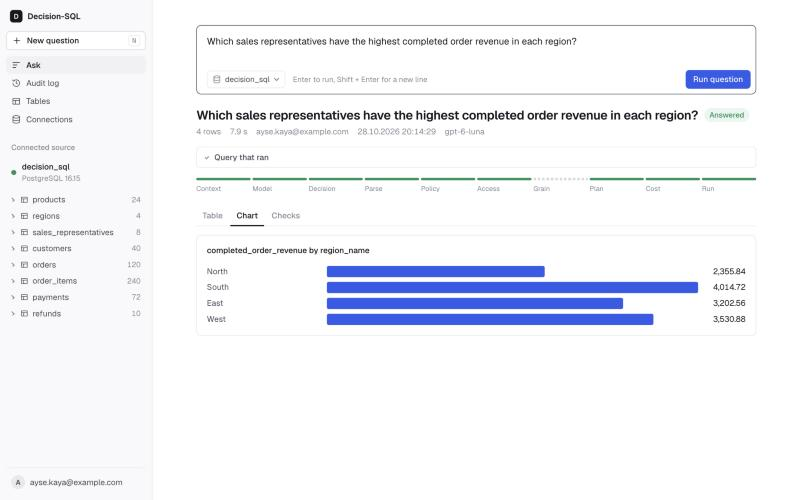
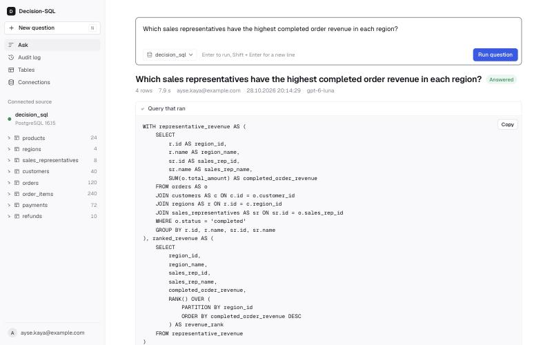
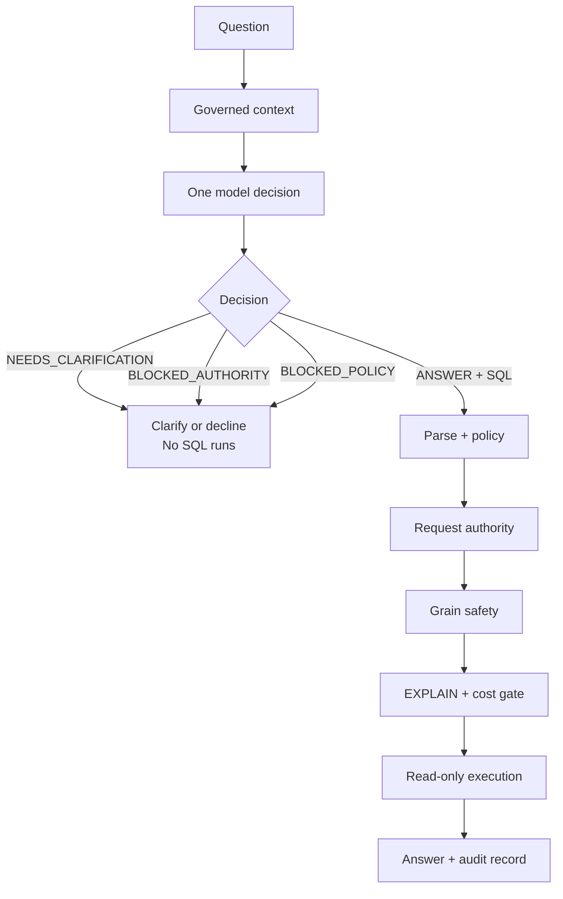
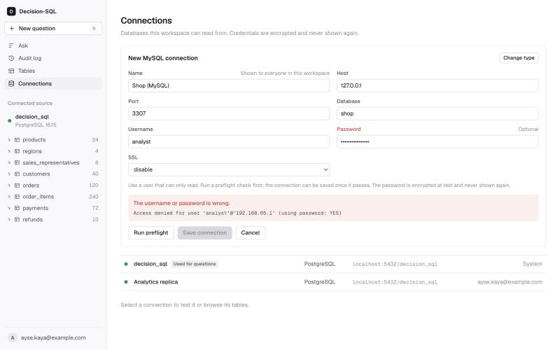
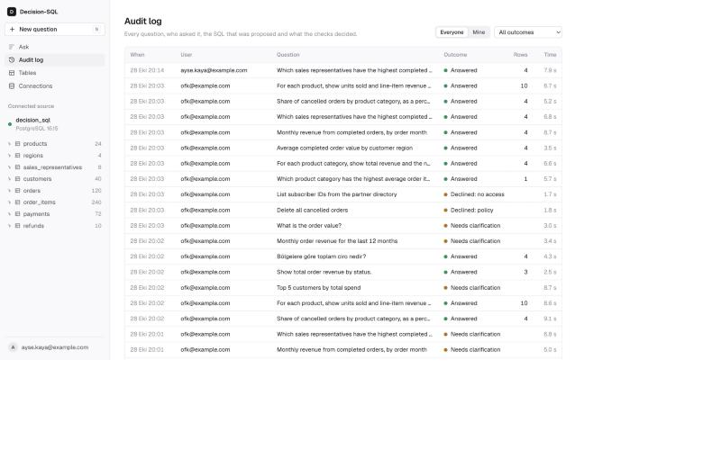

# Decision-SQL

**Ask questions of your database. The model proposes; deterministic code decides what runs.**

[](https://github.com/negativexq/decision-sql/actions/workflows/ci.yml)

Decision-SQL is a governed Text-to-SQL workspace. You pick a connected
database, ask a question in plain language, and get the answer as a table and a
chart, with the SQL that ran one click away. Every question is recorded in an
audit log with who asked it and what the checks decided.

The model makes one typed decision per question: `ANSWER` with read-only SQL,
`NEEDS_CLARIFICATION`, `BLOCKED_AUTHORITY`, or `BLOCKED_POLICY`. An answer is
only a proposal. Parsing, policy, authority, grain safety, `EXPLAIN` cost limits,
and read-only execution are deterministic code the model cannot bypass.



## What you can do

| | |
| --- | --- |
| **Ask** | Choose a database in the composer, ask in any language, read the answer as a table or chart. |
| **See the query** | Open "Query that ran" above the answer to read or copy the SQL. |
| **Follow the checks** | Ten stages from context to execution, each with its outcome and timing. |
| **Audit** | Every run with user, question, outcome, rows, and time; filter by user or outcome. |
| **Connect databases** | PostgreSQL, MySQL, SQL Server, Trino, Snowflake, BigQuery: enter the details, run a preflight, save once it passes. |



## How a question is answered



- **Governed context.** The model sees only queryable tables and columns, their
  relationships, and their business meaning (which column is revenue, which
  timestamp drives monthly trends). Small schemas are sent whole; large schemas
  are narrowed by retrieval.
- **One decision, no retries.** One request with a strict JSON schema. No repair
  loop, judge, or second call, so first-pass behavior stays visible.
- **Deterministic gates.** One `SELECT` statement, allowlisted functions,
  only relations in the request's context, no fan-out aggregates, and plan cost
  under the configured limit before anything executes.

Details: [architecture](docs/architecture.md) and [security posture](docs/security.md).

## Connections and audit



A connection is saved only after its preflight passes. Errors say what is wrong
and mark the field: wrong username or password, unreachable host or port,
missing database or schema, SSL. Passwords are encrypted at rest and never shown
again. Connector drivers are optional; an operator can install only the one they
need from the UI.

Questions currently run on the governed PostgreSQL source. Other saved
connections can be tested and their tables browsed; running questions on them
needs per-engine policy, read-only enforcement, and cost gates.



## Run it

```bash
docker compose up --build
```

| | |
| --- | --- |
| UI | http://localhost:3000 |
| API | http://localhost:8000 |

To answer live questions, set a model key before starting:

```bash
export DECISION_SQL_LLM_API_KEY=...
export DECISION_SQL_LLM_MODEL=gpt-6-luna
```

Any OpenAI-compatible endpoint works through `DECISION_SQL_LLM_BASE_URL`. See
[`.env.example`](.env.example) for every setting.

The API image ships without connector drivers. Install the ones you need with
`pip install ".[mysql]"` (or `sqlserver`, `trino`, `snowflake`, `bigquery`,
`connectors` for all), or from the UI when
`DECISION_SQL_ALLOW_DRIVER_INSTALL=true`.

## Develop

```bash
python -m pip install -e ".[dev]"
ruff check app tests
ruff format --check app tests
mypy app
pytest -q tests
```

```bash
npm --prefix ui ci
npm --prefix ui run build
```

Tests do not call a model. Integration tests under `tests/integration` run
against the Docker Compose PostgreSQL (and optional MySQL or Trino containers)
and skip when those are not reachable.

## Research history

Decision-SQL started as a measured research project: more than 60 milestones of
model-blind benchmark construction, one-shot evaluation, and forensic audits.
That work shaped the current decision contract (Candidate C) and the runtime
gates. It is kept on the `archive/research` branch: benchmark suites, runners,
reports, and the experimental generation pipelines.

| Evaluation | Result | Notes |
| --- | ---: | --- |
| Internal governed benchmark, 180 cases, 12 synthetic domains | 160/180 governed task success | Answerable runtime 108/122, authority 28/30, ambiguity 12/16, policy 12/12 |
| dbt ACME questions, local reproduction | 82/220 | 82 of 89 `ANSWER` decisions were correct; most misses were governed refusals over undefined business terms |
| BIRD Mini-Dev, PostgreSQL | 225/500 execution accuracy | Earlier direct SQL pipeline, not the current decision contract |

These numbers measure specific contracts and datasets. They are not a general
Text-to-SQL accuracy claim.

## Scope and limits

- No authentication yet: the audit log's user is self-declared until SSO.
- Authority is relation-level; there are no tenant predicates or row-level
  security.
- Questions run only on PostgreSQL.
- The demo catalog is a synthetic commerce schema with hand-written business
  definitions.

## Tech stack

Python 3.12, FastAPI, SQLAlchemy, Alembic, sqlglot, Pydantic, PostgreSQL 16,
OpenTelemetry, React, TypeScript, Vite, Docker Compose.

## License

[MIT](LICENSE)
