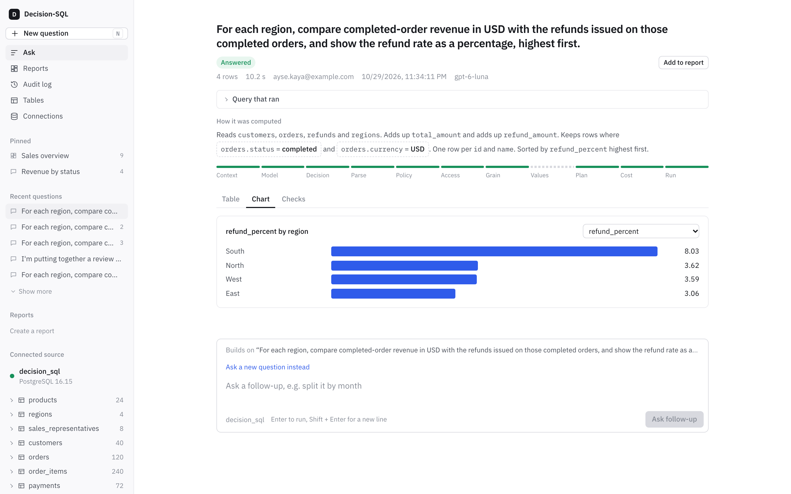
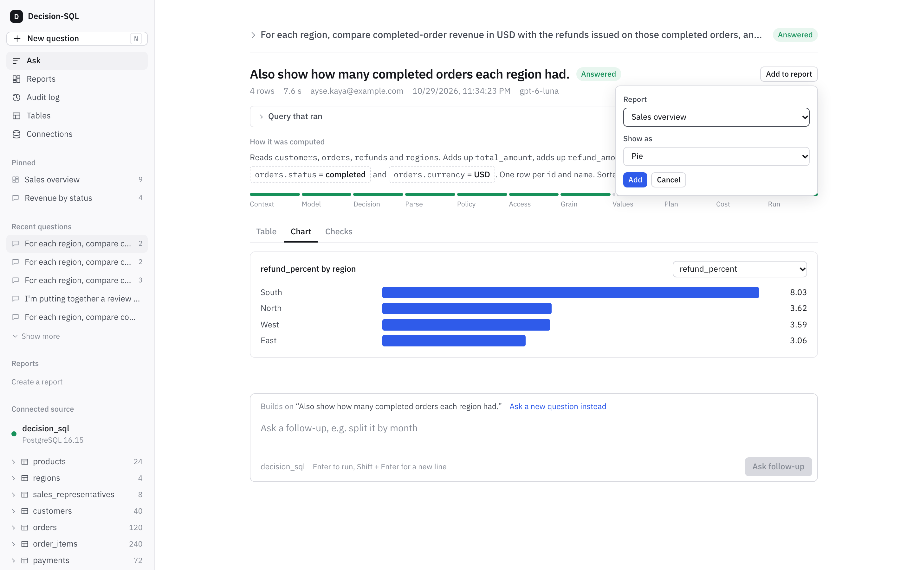
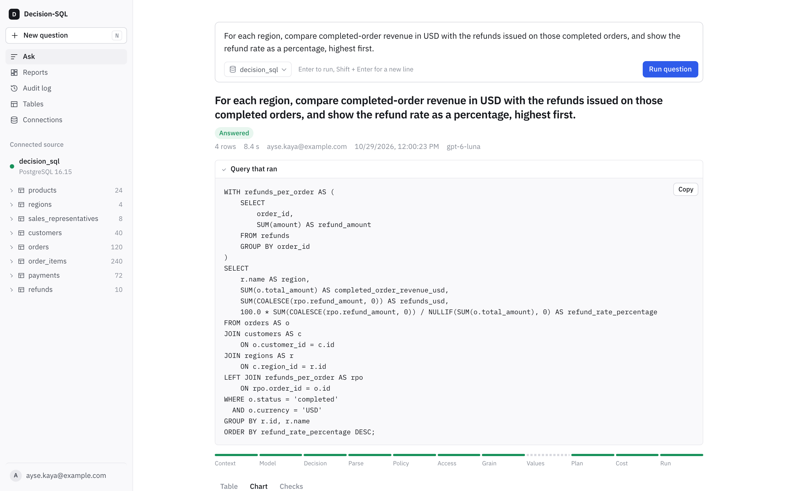
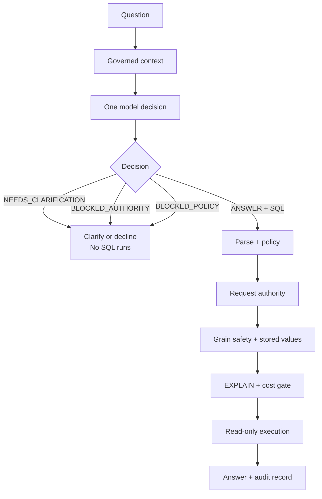
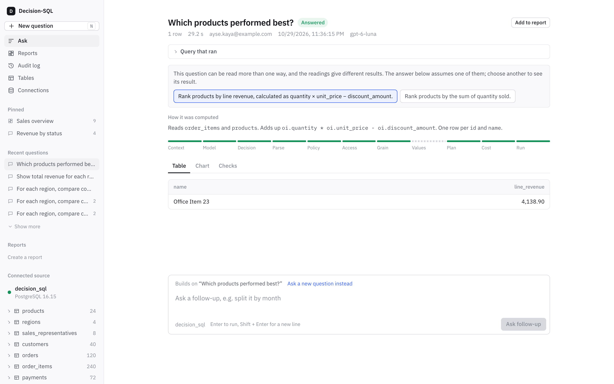
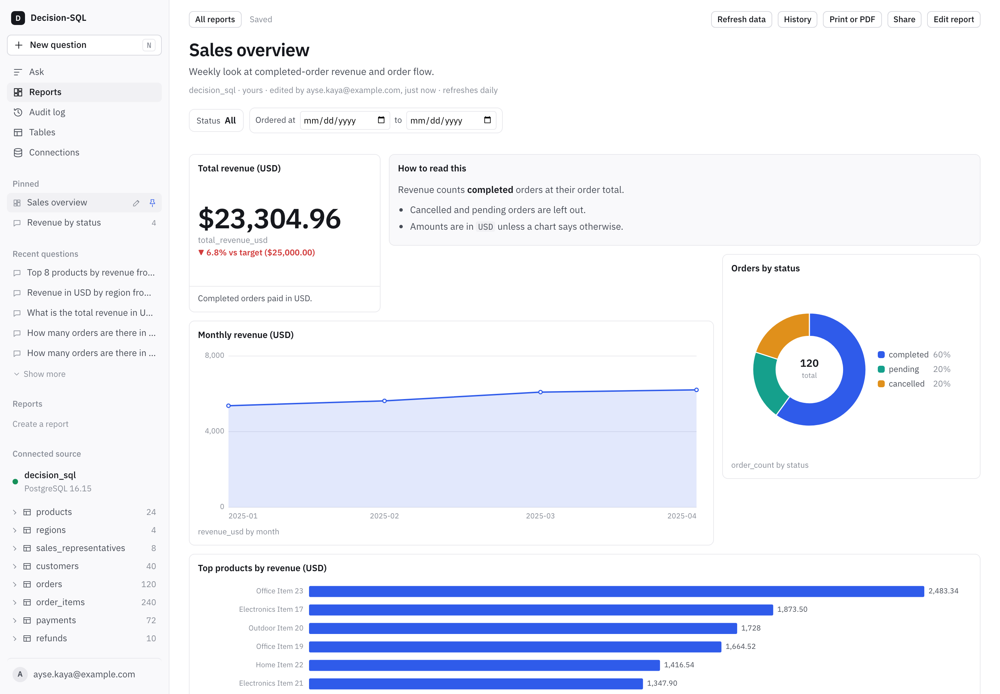
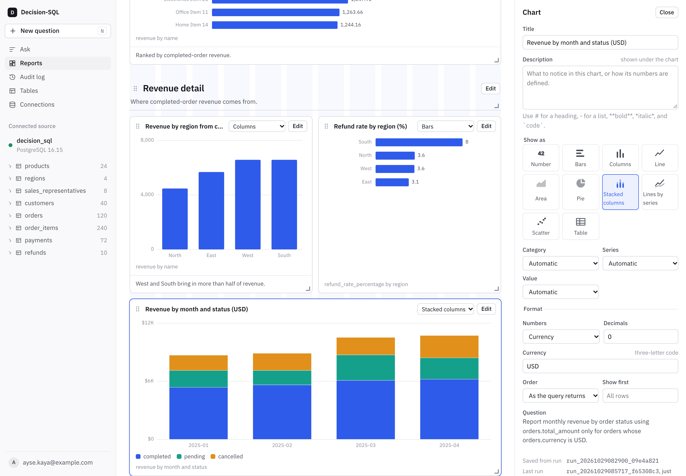
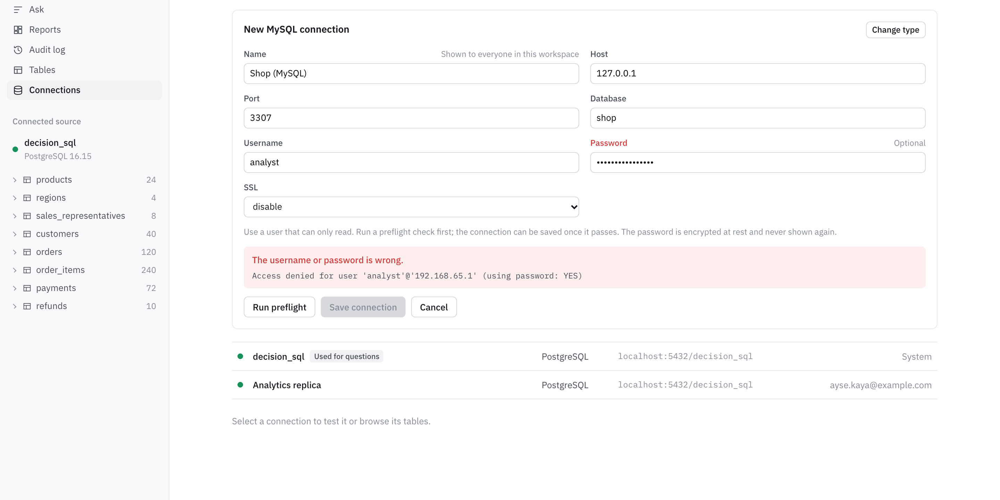
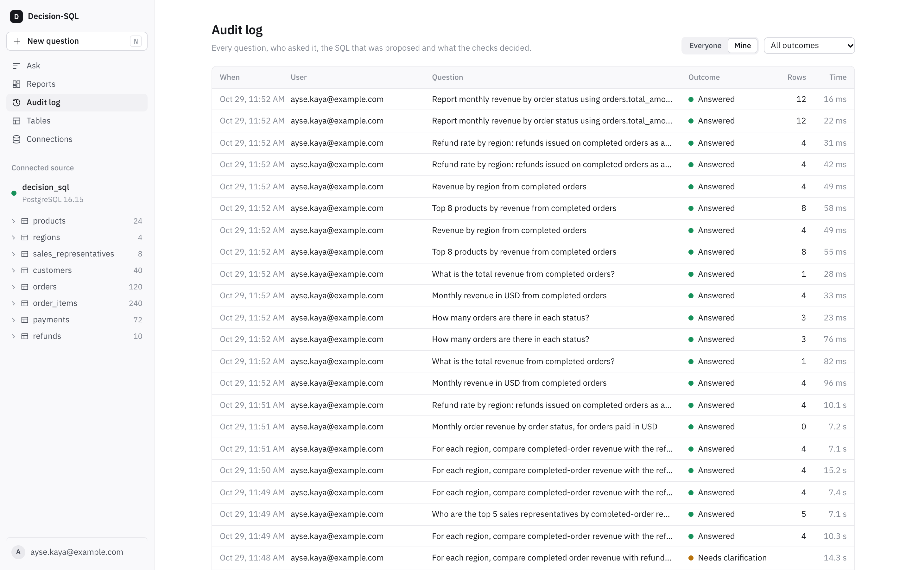

# Decision-SQL

**Ask questions of your database. The model proposes; deterministic code decides what runs.**

[](https://github.com/negativexq/decision-sql/actions/workflows/ci.yml)

Decision-SQL is a governed Text-to-SQL workspace. You pick a connected
database, ask a question in plain language, and get the answer as a table and a
chart, with the SQL that ran one click away. Every question is recorded in an
audit log with who asked it and what the checks decided.

The model makes one typed decision per question: `ANSWER` with read-only SQL,
`NEEDS_CLARIFICATION`, `BLOCKED_AUTHORITY`, or `BLOCKED_POLICY`. An answer is
only a proposal. Parsing, policy, authority, grain safety, `EXPLAIN` cost limits,
and read-only execution are deterministic code the model cannot bypass.

## Features

- **Answers you can check.** Every answer shows the SQL that ran, a line read
  from that SQL on what it counts and which rows it keeps, and the eleven
  checks it passed, filled in live while the question runs.
- **Conversations.** Follow up on an answer ("split it by month") and pick up
  recent conversations from the sidebar; rename them and pin the ones you
  return to.
- **Change an answer without the model.** Edit a condition, such as a date
  range or a status, or drop it; the query runs again through every check with
  no model call.
- **Ambiguity handled, not guessed.** When a question can be read two ways,
  each reading runs; the same result is answered, different results come with
  the other readings one click away, or a clarifying question.
- **Governed by code.** Only read-only `SELECT` on tables in scope, joins only
  along foreign keys or joins an administrator declared, no fan-out
  aggregates, and a cost limit before anything executes.
- **Looks before it answers.** The model may run a few gated probes to see how
  values are stored; a filter on a value the column does not hold is caught
  and respelled or reported.
- **Reports.** Add any answer to a report, or start a new one from it, as a
  chart on a shared page with filters, scheduled refresh, snapshots, CSV, and
  PDF. Reports sit in the sidebar next to your conversations.
- **Audit log.** Who asked what, which decision and SQL, and what each check
  decided, for every question.
- **Measured.** 74/100 on a fixed sample of BIRD Mini-Dev 2026 (PostgreSQL)
  with `gpt-6-luna`; see [Measurement](#measurement).



## What you can do

| | |
| --- | --- |
| **Ask** | Choose a database in the composer, ask in any language, read the answer as a table or chart. Follow up on an answer in the same conversation; recent conversations and reports stay in the sidebar, where you can rename them and pin them to the top. Add an answer to a report, or to a new one, as a chart. |
| **See how it was computed** | One line read from the query says what it counts, which rows it keeps, and how it groups and sorts. Change a condition, such as a date or a status, and it runs again through every check without asking the model. |
| **See the query** | Open "Query that ran" above the answer to read or copy the SQL. |
| **Follow the checks** | Eleven stages from context to execution, shown live while the question runs, each with its outcome and timing. |
| **Reports** | Build a page of charts from questions: number, bars, columns, line, area, pie, stacked columns, lines by series, scatter, or table. Drag and resize cards, add text sections, filters, and follow-up questions; share with editors and viewers, refresh on a schedule, keep snapshots, download rows as CSV, print or save as PDF. |
| **Audit** | Every run with user, question, outcome, rows, and time; filter by user or outcome. |
| **Connect databases** | PostgreSQL, MySQL, SQL Server, Trino, Snowflake, BigQuery: enter the details, run a preflight, save once it passes. |
| **Declare joins** | When a database has no foreign keys, declare the joins questions may use; each one is checked against the data before it is saved. |





## How a question is answered



- **Governed context.** The model sees only queryable tables and columns, their
  relationships (foreign keys and joins an administrator declared), the stored
  spellings of categorical text columns when an administrator shares them for
  that connection, and the SQL functions policy allows.
  Small schemas are sent whole; large schemas are narrowed by retrieval, and the
  tables left out are listed by name.
- **One decision, a fixed budget of calls.** One request with a strict JSON
  schema. If the checks reject SQL for a reason the model can fix (a parse
  error, an unknown column, a function outside the allowlist, the cost limit, a
  fan-out), it gets one repair round; if it names a table that was left out of
  the context, the context is widened once. Probes and checking a question's
  readings have their own allowances, so a question makes at most 7 model calls
  with the default settings, and most make one. A run also has a time, token,
  and probe-query budget that stops optional steps but never the first decision
  or the answering query, so it is not a hard end-to-end timeout. Authority
  and write rejections are final, and every call is in the trace.
- **A reason for every non-answer.** A clarification comes with the question to
  answer and the readings to choose from; a refusal names the missing join.

  
- **Deterministic gates.** One `SELECT` statement, allowlisted functions,
  only relations in the request's context, no fan-out aggregates, and plan cost
  under the configured limit before anything executes.

Details: [architecture](docs/architecture.md) and [security posture](docs/security.md).

## Reports



A report is a page of cards built from answered questions. Each chart keeps the
SQL that passed the checks when it was saved and reruns it through the same
gates whenever the report opens or refreshes. A chart whose tables were
redescribed since it was saved says which ones changed. Filters narrow every
card at once using values read from the data, and a follow-up from a card asks a
new question with that card's question as context.



In edit mode cards move and resize on a grid, and the side panel sets the chart
type, which columns are the category, series, and value, the number format, and
the order. Undo and redo cover every change. A report can refresh on a schedule
and keep snapshots of its rows; print bands stamp each page with when its data
was read.

## Connections and audit



A connection is saved only after its preflight passes. Errors say what is wrong
and mark the field: wrong username or password, unreachable host or port,
missing database or schema, SSL. Passwords are encrypted at rest and never shown
again. Connector drivers are optional; an operator can install only the one they
need from the UI.

Questions run on the governed source and on saved PostgreSQL connections,
using the connection's own read-only role. Saved connections to other engines
can be tested and their tables browsed; running questions on them needs
per-engine policy, read-only enforcement, and cost gates.



## Run it

```bash
docker compose up --build
```

| | |
| --- | --- |
| UI | http://localhost:3000 |
| API | http://localhost:8000 |

To answer live questions, set a model key before starting:

```bash
export DECISION_SQL_LLM_API_KEY=...
export DECISION_SQL_LLM_MODEL=gpt-6-luna
```

Any OpenAI-compatible endpoint works through `DECISION_SQL_LLM_BASE_URL`. See
[`.env.example`](.env.example) for every setting.

The API image ships without connector drivers. Install the ones you need with
`pip install ".[mysql]"` (or `sqlserver`, `trino`, `snowflake`, `bigquery`,
`connectors` for all), or from the UI when
`DECISION_SQL_ALLOW_DRIVER_INSTALL=true`.

## Develop

```bash
python -m pip install -e ".[dev]"
ruff check app tests
ruff format --check app tests
mypy app
pytest -q tests
```

```bash
npm --prefix ui ci
npm --prefix ui run build
```

Tests do not call a model. Integration tests under `tests/integration` run
against the Docker Compose PostgreSQL (and optional MySQL or Trino containers)
and skip when those are not reachable.
`tests/integration/test_grain_adversarial_postgres.py` pairs fan-out and
wrong-join SQL with a reference query: each wrong query must be refused by the
gate named for it and, where the demo data shows it, give different rows than
the reference; each right query must pass and return the reference's rows.

## Measurement

The current decision contract was measured on 2026-10-29 with `gpt-6-luna`.

| Evaluation | Result | Notes |
| --- | ---: | --- |
| Own field set: a wholesale schema with no foreign keys and no column descriptions, 31 questions, 3 runs each | 124/126 behaved as expected | Before any join was declared, all 30 join questions were refused. With joins declared: 67/69 answers matched the expected rows and none returned wrong rows (the other 2 asked for clarification), 12/12 ambiguous questions asked for clarification, 6/6 write requests were refused, and 6/6 questions about data the database does not hold were not answered. |
| BIRD Mini-Dev, PostgreSQL, stratified 100 questions (30 simple, 50 moderate, 20 challenging) | 59/100 execution accuracy | 59/82 without the 18 questions whose gold SQL is disputed (for example ties broken by `LIMIT 1`, or a hint that contradicts the gold query). Databases without foreign keys had their joins declared through the relationships screen first. |
| BIRD Mini-Dev 2026, PostgreSQL, a fixed random 100 of the 500 questions (93 challenging) | 74/100 execution accuracy | For comparison, the public leaderboard lists `gpt-6-luna` at 51.8 on the full 500. |

The field set checks behavior, not only rows: whether the system refuses a
join nobody authorized, asks when a question can be read two ways, and keeps
quiet about data it does not have. It was written by the same team as the
product, so it is a regression check rather than an independent score.

Decision-SQL started as a research project. Earlier contracts and pipelines
are kept on the `archive/research` branch with their benchmark suites and
reports:

| Earlier evaluation | Result | Notes |
| --- | ---: | --- |
| Internal governed benchmark, 180 cases, 12 synthetic domains | 160/180 governed task success | Answerable runtime 108/122, authority 28/30, ambiguity 12/16, policy 12/12 |
| dbt ACME questions, local reproduction | 82/220 | 82 of 89 `ANSWER` decisions were correct; most misses were refusals over undefined business terms |
| BIRD Mini-Dev, PostgreSQL, 500 questions | 225/500 execution accuracy | A direct SQL pipeline without the decision contract |

These numbers measure specific contracts and datasets. They are not a general
Text-to-SQL accuracy claim.

## Scope and limits

- No authentication yet: the audit log's user is self-declared until SSO.
- Authority is relation-level; there are no tenant predicates or row-level
  security.
- Questions run only on PostgreSQL.
- Grain and join checks follow columns through CTEs and derived tables, but a
  computed column joined on a non-key is not caught, and grain takes a grouped
  source nested inside another at its own grain.
- The demo catalog is a synthetic commerce schema with hand-written business
  definitions.

## Tech stack

Python 3.12, FastAPI, SQLAlchemy, Alembic, sqlglot, Pydantic, PostgreSQL 16,
OpenTelemetry, React, TypeScript, Vite, Docker Compose.

## License

[MIT](LICENSE)
